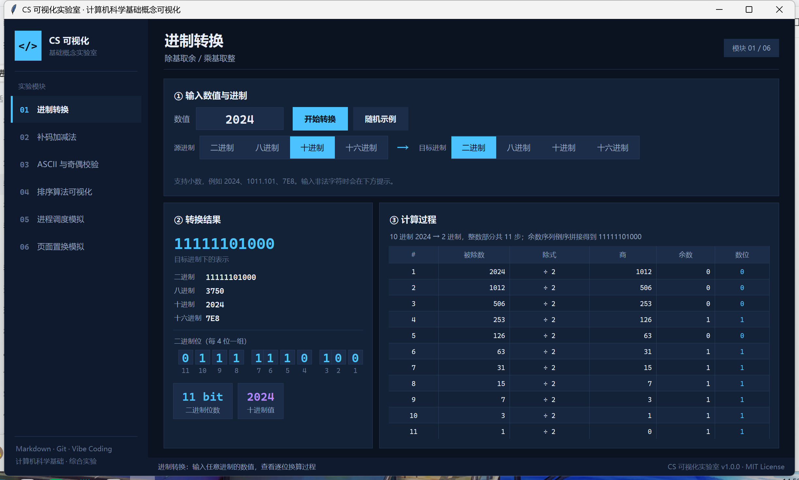
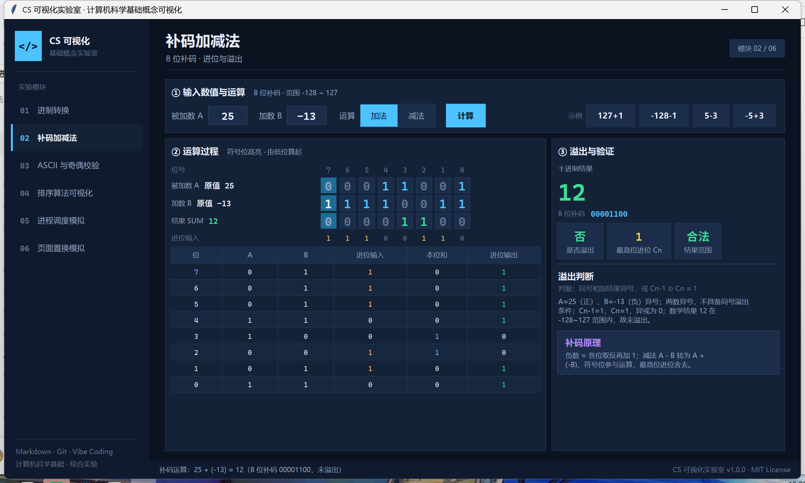
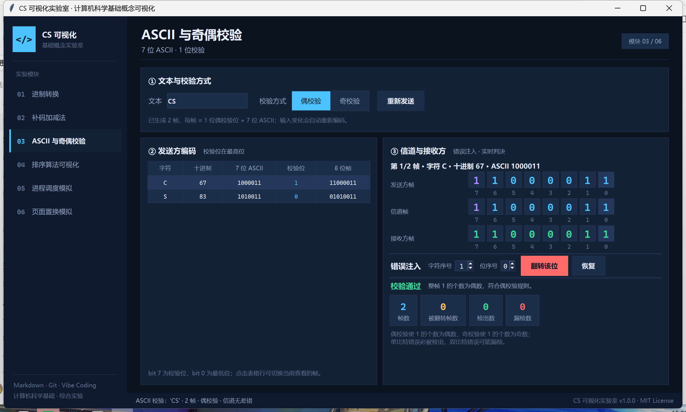
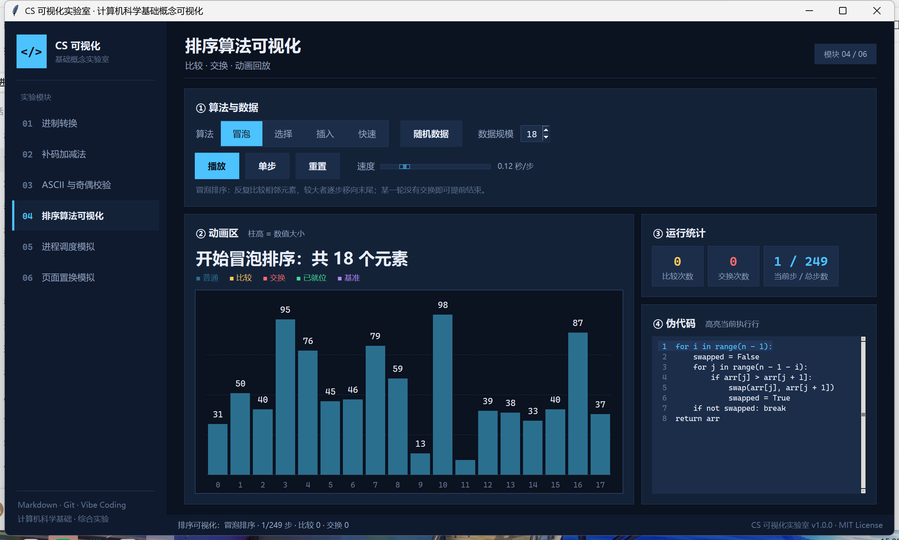
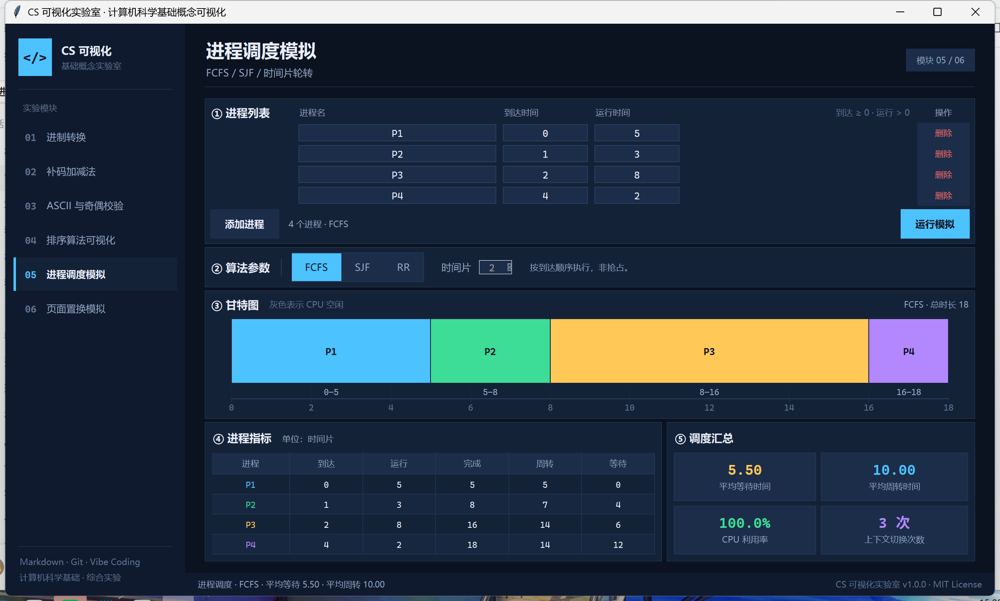
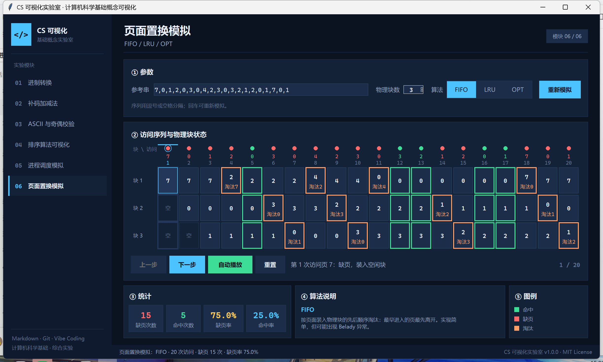

# CS 可视化实验室

> 计算机科学基础概念可视化探索 · 课程综合实验
>
> 一个用 Python + Tkinter 写成的桌面教学工具：把进制、补码、校验、排序、调度、页面置换的**计算过程**画出来。




---

## 项目简介

教材里的进制转换、补码溢出、LRU 淘汰往往只有一行公式。本项目把每一步中间状态摊开：

- **看得见进位**：补码加法逐列显示进位输入、本位和、进位输出。
- **看得见过程**：进制转换列出每一次除法的商与余数。
- **看得见错误**：ASCII 校验可以人为翻转某一位，观察接收方是否检出。
- **看得见对比**：同一组进程/访问串，一键切换算法比较指标。

项目只依赖 Python 标准库，克隆后即可运行。

---

## 功能一览

| # | 模块 | 能看到什么 | 可以怎么操作 |
|---|---|---|---|
| 01 | **进制转换** | 2/8/10/16 进制结果、二进制位条、除法与乘法过程表 | 输入任意进制数值、随机示例 |
| 02 | **补码加减法** | 8 位补码、逐位进位链、溢出判定与原因 | 输入 −128~127、加减切换、溢出示例 |
| 03 | **ASCII 与奇偶校验** | 7 位 ASCII、校验位、收发三帧对比 | 注入单/双比特翻转、查看检出与漏检 |
| 04 | **排序算法可视化** | 柱状动画、比较/交换计数、伪代码高亮 | 四种算法、单步/播放、调速、改数据规模 |
| 05 | **进程调度模拟** | FCFS/SJF/RR 甘特图、周转/等待/利用率 | 编辑进程表、切换算法、设置时间片 |
| 06 | **页面置换模拟** | FIFO/LRU/OPT 逐步矩阵、命中与淘汰 | 修改访问串、物理块数、单步/自动播放 |

### 运行截图

**补码加减法**：进位链与溢出判定



**ASCII 与奇偶校验**：注入一位错误



**排序算法可视化**：比较、交换与伪代码同步



**进程调度模拟**：甘特图与指标汇总



**页面置换模拟**：缺页、命中与淘汰



---

## 快速开始

### 环境要求

- Python **3.9 及以上**
- Tkinter（Windows 与 macOS 官方安装包自带）
- 无第三方运行时依赖

Linux 若缺少 Tkinter：

```bash
sudo apt install python3-tk
```

### 安装与运行

```bash
# 1. 克隆仓库
git clone https://github.com/YangLeyan666/cs-visualizer.git
cd cs-visualizer

# 2. 启动
python main.py
```

Windows 也可以直接双击 `main.py`，或在 VS Code 中按 `F5`。

### 快捷键

| 快捷键 | 功能 |
|---|---|
| `Ctrl + 1` ~ `Ctrl + 6` | 切换到对应模块 |
| `Enter` | 进制转换：执行转换 |
| 鼠标滚轮 | 滚动长表格 / 页面 |

### 模块自检

每个算法模块都可以脱离界面单独运行：

```bash
python -m core.number_base
python -m core.twos_complement
python -m core.parity
python -m core.sorting
python -m core.scheduling
python -m core.page_replacement
```

---

## 项目结构

```text
cs-visualizer/
├── main.py                  # 应用入口：主窗口、导航、模块注册
├── core/                    # 算法层（纯函数，不依赖 tkinter）
│   ├── number_base.py
│   ├── twos_complement.py
│   ├── parity.py
│   ├── sorting.py
│   ├── scheduling.py
│   └── page_replacement.py
├── ui/                      # 表现层
│   ├── theme.py             # 配色、字体、DPI 缩放
│   ├── widgets.py           # 卡片、分段选择器、表格、位条
│   ├── base_view.py
│   └── *_view.py            # 六个模块界面
├── docs/
│   ├── Project_Requirements_and_Design.md
│   ├── AI_Prompts_Log.md
│   └── assets/              # 架构图与运行截图
├── LICENSE
└── README.md
```

**分层约定**：`core/` 不导入 tkinter，界面不实现算法。这样算法可以单独自检，模块也可以并行开发。

---

## 团队分工

| 成员 | 角色 | 负责内容 | 分支 |
|---|---|---|---|
| 成员A | 组长 / 集成 | 仓库初始化、主框架、进制转换、README、冲突解决 | `feature/number-base` |
| 成员B | 算法开发 | 补码加减法模块 | `feature/twos-complement` |
| 成员C | 算法开发 | ASCII 与奇偶校验模块 | `feature/parity` |
| 成员D | 可视化开发 | 排序算法可视化模块 | `feature/sorting` |
| 成员E | 算法开发 | 进程调度、页面置换模块 | `feature/scheduling`、`feature/page-replacement` |

文档阶段全员在 `docs/feature-proposal` 分支提交各自章节，由组长发起 PR 审查后合并。

---

## Git 工作流

```text
main
 ├── 初始化（README / .gitignore / LICENSE）
 ├── docs/feature-proposal ──┐ 5 人分工提交文档
 │                            └── PR #1 → 合并
 ├── feature/number-base ───── PR #2 → 合并
 ├── feature/twos-complement ─ PR #3 → 合并
 ├── feature/parity ────────── PR #4 → 合并
 ├── feature/sorting ───────── PR #5 → 合并
 ├── feature/scheduling ────── PR #6 → 合并（解决 main.py 冲突）
 └── feature/page-replacement ─ PR #7 → 合并
```

- 提交信息遵循 `feat/fix/docs/refactor(scope): 说明` 格式。
- 每个功能分支推送后发起 PR，组长做 Code Review，使用 `--no-ff` 合并保留分支拓扑。
- 集成阶段主动制造一次冲突：成员D与成员E同时向 `main.py` 的 `MODULES` 列表追加模块，合并时按编号顺序保留双方条目。

详细过程见 [`docs/AI_Prompts_Log.md`](docs/AI_Prompts_Log.md)，需求与设计见 [`docs/Project_Requirements_and_Design.md`](docs/Project_Requirements_and_Design.md)。

---

## 开发过程

项目采用 Vibe Coding：先用自然语言描述界面与算法，由 AI 生成初版，再通过**运行 → 读错误 → 定位 → 小步修复**收敛。

- AI 负责：界面骨架、控件封装、算法初版、重复性布局。
- 人负责：需求拆解、边界条件、真实环境验证（DPI、窗口尺寸）、代码审查与提交。
- 典型修正：`Segmented` 属性名与 Tkinter 内部 `_options()` 冲突、Canvas 默认宽度撑破布局、高分屏下未做像素缩放、`after` 回调在窗口销毁后触发。

完整的提示词、AI 原始输出与修复记录见 [`docs/AI_Prompts_Log.md`](docs/AI_Prompts_Log.md)。

---

## 常见问题

**Q：启动报 `No module named tkinter`？**
A：Linux 安装 `python3-tk`；Windows 请使用 python.org 官方安装包并勾选 tcl/tk。

**Q：界面字很小 / 很大？**
A：程序会读取系统 DPI 自动缩放。若使用远程桌面导致缩放异常，可在 `ui/theme.py` 中把 `init_scale` 的返回值固定为 1.0。

**Q：补码模块为什么只有 8 位？**
A：课程以 8 位为主，便于一屏显示进位链。核心函数 `to_bits(value, width)` 本身支持其他位宽，后续可扩展界面。

---

## 开源协议

本项目使用 [MIT License](LICENSE)，可自由用于学习、教学与二次开发，请保留版权声明。

## 贡献者

- 成员A —— 主框架、进制转换、集成与文档
- 成员B —— 补码加减法
- 成员C —— ASCII 与奇偶校验
- 成员D —— 排序算法可视化
- 成员E —— 进程调度、页面置换

感谢课程讲义与开源社区提供的思路。
