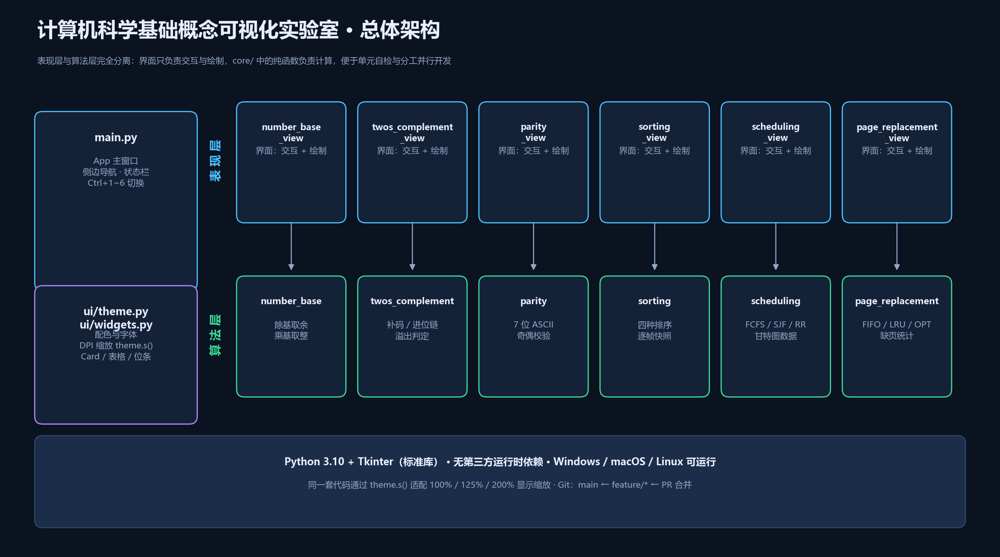

# 计算机科学基础概念可视化实验室

> **项目需求与设计文档**（Project Requirements and Design）
>
> 课程：计算机科学基础 · 综合实验
> 版本：v1.2（选题审核修订版）
> 日期：2026-10-26
> 团队：第 5 组（5 人）
> 仓库：`cs-visualizer`（Gitee / GitHub，见 README 徽章）

---

## 1. 项目概述

### 1.1 项目背景

计算机科学基础课程中的进制、补码、校验、排序、调度、存储管理等概念，教材通常只用静态公式和文字描述。学习者在理解"余数为什么要倒着读""溢出为什么能用异或判断""LRU 到底淘汰了谁"时，缺少可以逐步观察的中间状态。

本项目使用 **Python + Tkinter** 开发一个桌面端可视化实验室，把六类基础概念的**计算过程**而非仅结果呈现出来。开发过程采用 **Vibe Coding**：由自然语言提示词驱动 AI 生成代码，团队成员负责拆解需求、审查输出、定位错误并修复。

### 1.2 项目目标

- **教学价值**：每个模块都能展示"输入 → 中间状态 → 输出"的完整链路，而不是一个黑盒计算器。
- **工程规范**：以真实多人协作方式完成，包含需求文档、分支开发、Pull Request、代码审查与冲突解决。
- **可复现**：仓库克隆后无需安装第三方依赖，执行 `python main.py` 即可运行。

### 1.3 项目范围

**包含：**

1. 六模块桌面应用：进制转换、补码加减、ASCII 与奇偶校验、排序算法可视化、进程调度、页面置换。
2. 统一暗色主题、侧边导航、状态栏与 DPI 自适应。
3. 需求文档、AI 提示词日志、README 与开源协议。
4. 完整 Git 历史：功能分支、PR 合并记录、一次真实冲突的解决记录。

**不包含：**

- 用户账号、联网同步、数据库持久化。
- 移动端适配。
- 任意位宽的补码运算（固定 8 位，聚焦教学演示）。

---

## 2. 需求分析

### 2.1 目标用户与使用场景

| 用户 | 场景 | 核心诉求 |
|---|---|---|
| 计算机基础课学生 | 课后复习进制、补码、校验 | 能逐步回放计算过程，看清每一位 |
| 算法初学者 | 理解排序比较与交换 | 动画可暂停、可单步，配合伪代码 |
| 操作系统课程学生 | 理解调度与页面置换 | 同一组数据切换算法对比指标 |
| 任课教师 | 课堂演示 | 一键启动、界面清晰、可投影 |

### 2.2 功能需求

| 编号 | 模块 | 需求描述 | 优先级 |
|---|---|---|---|
| **FR-01** | 进制转换 | 支持 2/8/10/16 进制互转，展示整数"除基取余"与小数"乘基取整"的每一步 | P0 |
| **FR-02** | 补码加减 | 8 位补码加减，展示逐位进位链、最高位进位与溢出判定 | P0 |
| **FR-03** | ASCII 校验 | 7 位 ASCII 编码 + 奇/偶校验位，支持注入位翻转并给出接收方判决 | P0 |
| **FR-04** | 排序可视化 | 冒泡/选择/插入/快速排序动画，统计比较与交换次数，伪代码同步高亮 | P0 |
| **FR-05** | 进程调度 | FCFS/SJF/RR 甘特图与周转、等待时间、CPU 利用率 | P0 |
| **FR-06** | 页面置换 | FIFO/LRU/OPT 逐步矩阵、缺页率与淘汰页标记 | P0 |
| **FR-07** | 通用交互 | 侧边导航、`Ctrl+1`~`Ctrl+6` 快捷键、状态栏反馈 | P1 |
| **FR-08** | 显示适配 | 在 100%/125%/200% 缩放下布局不裁切 | P1 |
| **FR-09** | 错误处理 | 非法输入给出中文提示，不崩溃、不静默 | P1 |

### 2.3 非功能需求

- **性能**：模块切换 < 200 ms；排序 44 个元素、页面置换 120 次访问时动画仍流畅。
- **可维护性**：界面与算法分层，`core/` 内为无界面依赖的纯函数，可单独运行自检。
- **可移植性**：仅使用 Python 标准库；Windows 为主，macOS/Linux 可运行。
- **一致性**：颜色、字体、间距统一从 `ui/theme.py` 读取，禁止在业务代码中写死颜色。
- **可读性**：中文界面，变量与函数使用英文命名，关键算法保留中文注释。

### 2.4 验收标准

1. 六个模块均可用默认示例数据直接出结果，界面无空白页。
2. 每个 `core/*.py` 执行 `python -m core.<模块>` 自检通过。
3. 关闭窗口、切换模块、重复播放/重置均无异常。
4. 在 1280×800 逻辑分辨率（200% 缩放的 2560×1600 屏幕）下内容完整可见。
5. `git log --graph` 可看到功能分支与合并记录，冲突解决提交可追溯。

---

## 3. 总体设计

### 3.1 系统架构



系统分为三层：

1. **应用外壳层**：`main.py` 负责窗口、导航、模块注册与生命周期；`ui/theme.py` 与 `ui/widgets.py` 提供配色、字体、DPI 缩放和通用控件。
2. **表现层**：`ui/*_view.py` 六个模块界面，只处理输入收集、状态展示与 Canvas 绘制。
3. **算法层**：`core/*.py` 六个纯逻辑模块，不导入 tkinter，可独立测试。

> **设计原则**：界面不实现算法，算法不依赖界面。这样每个模块可以由不同成员并行开发，合并时互不冲突。

### 3.2 目录结构

```text
cs-visualizer/
├── main.py                     # 应用入口、主窗口、模块注册
├── README.md                   # 安装运行、截图、分工、协议
├── LICENSE                     # MIT
├── .gitignore
├── core/                       # 纯算法层（无界面依赖）
│   ├── number_base.py          # 进制转换
│   ├── twos_complement.py      # 补码加减
│   ├── parity.py               # ASCII 与奇偶校验
│   ├── sorting.py              # 四种排序的逐帧状态
│   ├── scheduling.py           # FCFS / SJF / RR
│   └── page_replacement.py     # FIFO / LRU / OPT
├── ui/                         # 表现层
│   ├── theme.py                # 配色、字体、DPI 缩放
│   ├── widgets.py              # Card / Segmented / DataTable / BitStrip
│   ├── base_view.py            # 模块基类
│   └── *_view.py               # 六个模块界面
└── docs/
    ├── Project_Requirements_and_Design.md
    ├── AI_Prompts_Log.md
    └── assets/                 # 架构图与运行截图
```

### 3.3 模块划分

| 模块 | 界面文件 | 算法文件 | 核心数据结构 |
|---|---|---|---|
| 进制转换 | `ui/number_base_view.py` | `core/number_base.py` | `steps: list[dict]` |
| 补码加减 | `ui/twos_complement_view.py` | `core/twos_complement.py` | `steps: list[dict]`、进位链 |
| ASCII 校验 | `ui/parity_view.py` | `core/parity.py` | 8 位帧字符串 |
| 排序可视化 | `ui/sorting_view.py` | `core/sorting.py` | 逐帧快照 `frame: dict` |
| 进程调度 | `ui/scheduling_view.py` | `core/scheduling.py` | `timeline` + `metrics` |
| 页面置换 | `ui/page_replacement_view.py` | `core/page_replacement.py` | `steps` + `frames` 快照 |

### 3.4 界面设计

- **布局**：左侧 220 px 导航（模块编号 + 名称），右侧为"标题区 + 内容区 + 状态栏"。
- **配色**：深蓝背景 `#0b1220`，卡片 `#142238`，强调色 `#4cc2ff`，语义色：成功 `#3ddc97`、警告 `#ffc857`、错误 `#ff6b6b`。
- **字体**：中文 Microsoft YaHei UI，等宽 Cascadia Mono；字号以 pt 为单位，随系统 DPI 自动缩放。
- **DPI 适配**：`theme.s(px)` 把设计稿像素换算为实际像素（192 DPI 时 ×2），避免高分屏下字体与容器比例失调。

### 3.5 数据流（以补码为例）

```text
用户输入 A、B 与运算符
        ↓
core.twos_complement.analyze(a, b, op)
        ↓ 返回 a_bits / b_bits / result_bits / steps / overflow
ui.twos_complement_view 渲染位条、进位行、逐位表格与溢出结论
        ↓
app.set_status() 写入底部状态栏
```

**关键点**：界面拿到的是**完整的结果对象**，不参与运算；所有中间状态由算法层一次性算好，便于回放与测试。

---

## 4. 模块详细设计

### 4.1 进制转换演示器

**输入**：任意进制的整数或小数（如 `2024`、`1011.101`、`7E8`）。

**输出**：目标进制字符串、四种进制对照、二进制位条、逐步过程表。

**算法**：

1. 整数部分：不断 `divmod(n, base)`，记录商与余数，余数**倒序**拼接。
2. 小数部分：不断乘以基数，取整数位，**正序**拼接，最多 8 位。
3. 非法字符在解析阶段抛出 `ValueError`，界面显示中文错误。

**界面**：顶部两行输入区；左卡片显示结果与位条；右卡片显示除法表与乘法表。

### 4.2 补码加减法运算模拟器

**输入**：两个 −128 ~ 127 的整数，加法或减法。

**输出**：补码位串、逐位进位链、十进制结果、溢出标志与原因。

**算法**：

- 负数补码 = 按位取反加一；`to_bits` 拒绝越界值。
- 减法转化为 `A + (−B)` 的补码加法。
- 逐列相加，`carry_out = (a + b + carry_in) // 2`。
- **溢出判据**：符号位进位 `Cn-1` 与最高位进位 `Cn` 异或为 1；等价于"同号相加结果异号"。
- 特例：`−128` 取反得到 `10000000`，超出 8 位可表示范围，单独给出说明而不静默出错。

**界面**：三条位条（A、B/−B、SUM）+ 进位输入行 + 8 行逐位表 + 右侧溢出判定卡。

### 4.3 ASCII 码与奇偶校验收发模拟

**输入**：ASCII 文本、校验方式（偶/奇）、人为翻转的位。

**输出**：每字符 7 位 ASCII、校验位、8 位帧、接收方判决、检出/漏检统计。

**算法**：

- `parity_bit` 使 8 位帧中 1 的个数为偶数（偶校验）或奇数（奇校验）。
- 接收方重新统计 1 的个数：不符则判定出错。
- 单比特错误必被检出；双比特错误改变 1 的个数的奇偶性不变，因此**漏检**，界面明确提示这一局限。

**界面**：左侧编码表；右侧发送帧、信道帧（翻转位红色）、接收帧三条位条与错误注入控件。

### 4.4 排序算法可视化

**输入**：8~44 个随机整数、算法、速度。

**输出**：柱状图动画、比较/交换计数、伪代码高亮行。

**算法**：四种排序均实现为**生成器**，每步 `yield` 一个不可变快照：

```python
{"array": [...], "compare": [i, j], "swap": [i, j], "pivot": k,
 "sorted": {...}, "line": 伪代码行号, "comparisons": n, "swaps": n,
 "message": "中文说明"}
```

快照机制让"单步 / 播放 / 重置"共用同一份数据，避免动画与统计不同步。

**界面**：Canvas 柱状图（比较黄、交换红、就位绿、基准紫），右侧统计卡与伪代码面板。

### 4.5 进程调度模拟

**输入**：进程列表（名称、到达时间、运行时间）、算法、时间片。

**输出**：甘特图、每进程完成/周转/等待时间、平均值、CPU 利用率、切换次数。

**算法**：

- **FCFS**：按到达时间非抢占执行。
- **SJF**：每次从已到达进程中选运行时间最短者（相同则按到达时间、进程名）。
- **RR**：就绪队列轮转；时间片结束时，新到达进程先入队，被抢占进程再入队尾。
- 空闲区间单独记录为 `pid="空闲"`，不计入 CPU 利用率。

**界面**：可编辑进程表 + 算法参数 + Canvas 甘特图 + 指标表 + 汇总卡。

### 4.6 页面置换模拟

**输入**：访问串、物理块数（1~6）、算法。

**输出**：逐步物理块矩阵、缺页/命中/淘汰标记、缺页率。

**算法**：

- **FIFO**：队列记录装入顺序，淘汰队首页。
- **LRU**：记录每页最近使用下标，淘汰最久未使用者。
- **OPT**：向后查找每页下一次使用位置，淘汰"未来最远"的页；不再出现视为无穷远。

**界面**：Canvas 矩阵（列=访问、行=物理块），命中绿框、缺页红点、淘汰橙框；底部统计与图例。

---

## 5. 团队分工

| 成员 | 角色 | 负责模块 | 功能分支 | 主要交付 |
|---|---|---|---|---|
| **成员A** | 组长 / 集成 | 主框架、进制转换 | `feature/number-base` | 仓库初始化、`main.py`、主题与控件、README、冲突解决 |
| **成员B** | 算法开发 | 补码加减 | `feature/twos-complement` | `core/twos_complement.py` 与界面、溢出判定 |
| **成员C** | 算法开发 | ASCII 与奇偶校验 | `feature/parity` | `core/parity.py` 与界面、错误注入 |
| **成员D** | 可视化开发 | 排序算法 | `feature/sorting` | 四种排序生成器、柱状动画、伪代码高亮 |
| **成员E** | 算法开发 | 进程调度、页面置换 | `feature/scheduling`、`feature/page-replacement` | 五种调度/置换算法、甘特图与矩阵 |

**文档阶段**：全员在 `docs/feature-proposal` 分支各自提交负责章节，由组长发起 PR 并审查合并。

---

## 6. 开发计划

| 阶段 | 时间 | 交付物 | 负责人 |
|---|---|---|---|
| M1 需求与选题 | 10-08 ~ 10-12 | 仓库、`README.md` 骨架、需求文档初稿 | 全员 |
| M2 选题审核 | 10-13 ~ 10-14 | 教师评审意见与修订版文档 | 成员A |
| M3 核心开发 | 10-15 ~ 10-22 | 六个模块与算法自检 | B/C/D/E |
| M4 集成与冲突 | 10-23 ~ 10-24 | 主分支合并、冲突解决记录 | 成员A |
| M5 交付 | 10-25 ~ 10-26 | README 截图、AI 日志、课堂演示 | 全员 |

---

## 7. Git 协作规范

### 7.1 分支模型

- `main`：随时可运行的稳定分支，只接受 PR 合并。
- `docs/feature-proposal`：需求文档协作分支。
- `feature/<module>`：每个模块一条功能分支，命名使用小写中划线。
- 修复分支：`fix/<topic>`。

### 7.2 提交信息规范

采用 Conventional Commits 简写形式：

```text
feat(parity): 增加单比特错误注入
fix(sorting): 修复暂停后 after 回调未取消
docs(proposal): 补充页面置换验收标准
refactor(core): 拆分调度指标计算
```

### 7.3 Pull Request 流程

1. 功能分支完成后 `git push origin feature/<module>`。
2. 在平台发起 PR，填写**变更内容 / 验证方式 / 截图**。
3. 组长进行 Code Review：检查命名、边界条件、是否有调试残留。
4. 至少 1 人批准后合并到 `main`，使用 `--no-ff` 保留分支拓扑。

### 7.4 冲突处理

集成阶段成员D与成员E同时修改了 `main.py` 的 `MODULES` 列表末尾：

```text
<<<<<<< HEAD
    ("sorting", "04", "排序算法可视化", ...),
=======
    ("scheduling", "05", "进程调度模拟", ...),
>>>>>>> feature/scheduling
```

处理原则：**保留双方新增条目**，按编号排序，运行程序确认六个模块均可打开，再 `git add main.py && git commit`。

---

## 8. 风险与应对

| 风险 | 影响 | 应对 |
|---|---|---|
| AI 生成代码与 Tkinter 内部 API 冲突 | 运行时报 `TypeError` | 小步运行、保留错误回溯、定位后做最小修改 |
| 高分屏下布局裁切 | 演示效果差 | 统一 `theme.s()` 缩放，按 200% 实机截图验收 |
| 多人同时改 `main.py` | 合并冲突 | 冲突作为实验要求主动演练，按模块编号顺序解决 |
| 动画回调在窗口销毁后触发 | 关闭时报错 | 暂停/重置/销毁前统一 `after_cancel` |
| 算法边界（LLM 易忽略） | 结果错误 | 每个 `core` 模块内置自检，覆盖 −128、空串、单块等边界 |

---

## 9. 参考资料

1. 课程讲义《计算机科学基础》第 2 章 数据表示、第 5 章 排序与查找。
2. Python 官方文档：`tkinter`、`tkinter.ttk`。
3. Git 官方文档：<https://git-scm.com/doc>。
4. Conventional Commits：<https://www.conventionalcommits.org/>。
5. 操作系统教材：进程调度与虚拟内存章节。

---

**文档状态**：已按教师评审意见补充"验收标准"与"风险应对"两节，等待复审。
